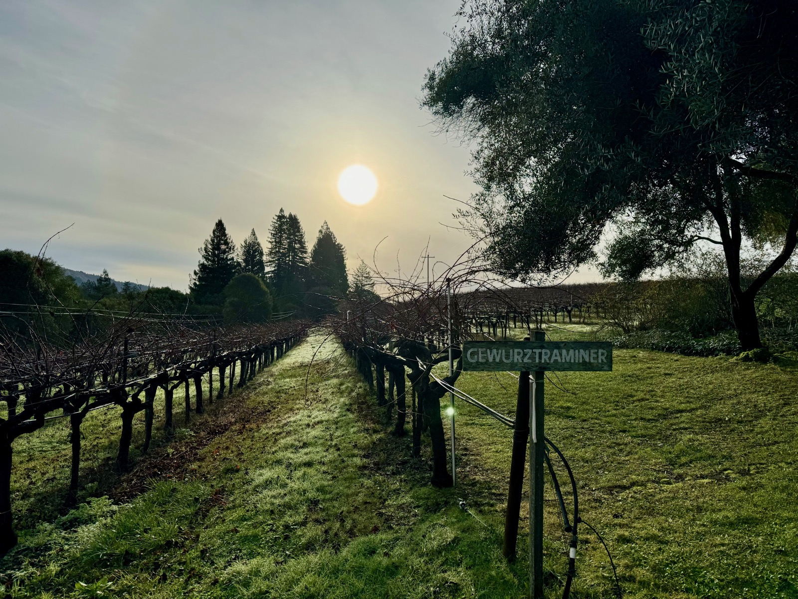

# Anderson Valley

Anderson Valley is a wine-growing valley in Mendocino County, northern
California, running inland from the Pacific through the Navarro River
watershed. [Pinot Noir](../grapes/pinot-noir.md),
[Chardonnay](../grapes/chardonnay.md), and traditional-method sparkling wine
are central to its modern identity. Aromatic whites, particularly
[Gewürztraminer](../grapes/gewurztraminer.md) and
[Riesling](../grapes/riesling.md), give the region a longer and more varied
story than Pinot alone.

The valley became an American Viticultural Area in 1983. Its development
combined local growers and small wineries with investment in sparkling wine,
creating several different uses for fruit from this relatively cool
California setting.

## The Deep End and the hills

Ocean air and fog travel inland along the valley. The northwestern part,
known locally as the Deep End, is especially exposed to that influence.
Farther inland, conditions can be warmer. A vineyard's position on a slope
also changes its exposure to fog, sunshine, and cold air.

Elevated sites may emerge above the fog earlier in the morning. Some also
avoid the coldest air that collects lower down during clear nights. The
result can be a smaller daily temperature swing than on the valley floor,
despite the greater elevation. This is why a description such as “cool
climate” needs a site and season attached to it.

The contrast matters particularly for early-ripening grapes. A gradual season
can give growers time to choose their balance of sugar, aroma, and
[acidity](../concepts/acidity.md); heat during the final stages can compress
that window. In its 2024 newsletter, Navarro described adjusting shade and
using cooling water during hot conditions for Gewürztraminer, while reporting
that the cooler 2023 season had delayed ripening favourably. This is a
producer's account of particular seasons and adaptations, not evidence that
all valley sites respond alike.

## Still wines and aromatic whites

Still Pinot Noir involves decisions about skin extraction and harvest
ripeness quite different from those used for a pale sparkling base wine.
Single-vineyard bottlings also let producers distinguish the valley's warmer,
cooler, higher, and more sheltered sites. Colour and body vary with those
conditions as well as the handling of skins and stems.

Navarro gives a concrete example of aromatic white winemaking. Its 2023 Deep
End Gewürztraminer was picked at night, given a cold soak, fermented cool in
large oak ovals, and held on its lees for seven months. Large wooden vessels
and [lees ageing](../concepts/lees-aging.md) can provide a route to texture
without making new-barrel aroma the principal feature of the wine.

The producer's range includes dry aromatic whites, an off-dry Edelzwicker
blend, and sweet late-harvest wines. The floral scent of Gewürztraminer or
Riesling therefore does not tell the drinker how much
[residual sugar](../concepts/residual-sugar.md) remains. Sweetness is a separate
stylistic decision.

## Sparkling wine as a distinct harvest goal

Fruit for sparkling wine is generally picked with less sugar and more
retained acidity than fruit destined for many still wines. The
[traditional method](../styles/traditional-method-sparkling-wine.md) then
adds a second fermentation in bottle and maturation on the resulting yeast
sediment. Growing conditions support the base wine; blending and time shape
the finished sparkling wine.

Roederer Estate documents this distinction through estate-grown fruit and a
reserve-wine programme. It holds selected still wines in large oak casks
before including them in later blends, then uses bottle fermentation and
lees maturation. Older reserve wine supplies another component alongside
the current harvest. Its first sparkling release in 1988 followed earlier
regional activity by Scharffenberger and Handley, showing how sparkling
production became an enduring part of the valley's wine culture.

## Sources

- Anderson Valley Winegrowers Association, [“Why Is Anderson Valley So Good
  for Growing Pinot
  Noir?”](https://avwines.com/blog/why-is-anderson-valley-so-good-for-growing-pinot-noir/),
  geographical and climatic overview, accessed 6 October 2026.
- Anderson Valley Winegrowers Association, [“Cheers to Anderson Valley for
  Forty Years as an
  AVA”](https://avwines.com/blog/cheers-to-anderson-valley-for-forty-years-as-an-ava/),
  2023.
- Navarro Vineyards, [*Summer
  2024*](https://www.navarrowine.com/media/pdf/NavarroSummer24.pdf), vineyard
  and winemaking notes for the 2023 releases.
- Roederer Estate,
  [“Winemaking”](https://roedererestate.com/about/winemaking/), reserve wines
  and sparkling production, accessed 6 October 2026.
