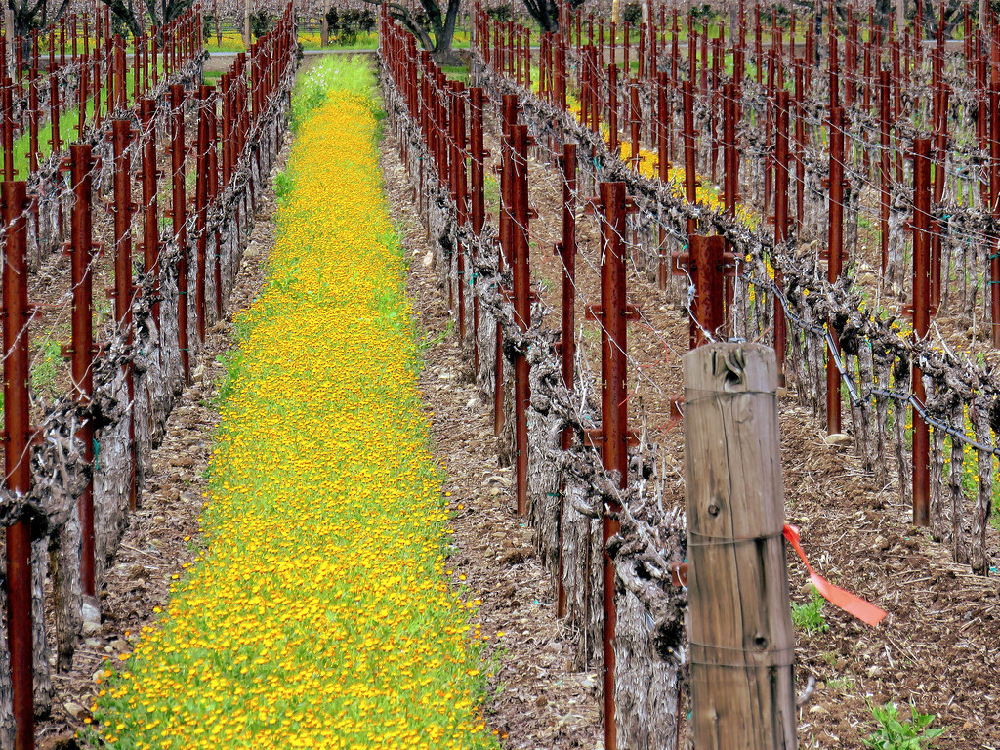

# Napa Valley

Napa Valley is a wine region north of San Francisco, east of
[Sonoma County](sonoma-county.md). Its modern identity centres on
[Cabernet Sauvignon](../grapes/cabernet-sauvignon.md), but the valley also
supports Chardonnay, Sauvignon Blanc, other Bordeaux varieties, and older
plantings of [Zinfandel](../grapes/zinfandel.md). Understanding Napa requires moving between the valley
floor, its adjoining slopes, and the cooler southern vineyards near San Pablo
Bay.

The Napa Valley American Viticultural Area, or AVA, contains smaller named
areas such as Rutherford, Oakville, Howell Mountain, and Coombsville. These
names identify growing places. They do not prescribe a common blend or a
single approach to ripeness and maturation.

## Warmth, marine air, and elevation

The valley lies between the Mayacamas and Vaca ranges. Marine air entering
from the south helps moderate the southern districts, while sheltered inland
sites can accumulate more heat. [Carneros](carneros.md) provides an important setting for
[Chardonnay](../grapes/chardonnay.md) and
[Pinot Noir](../grapes/pinot-noir.md). Coombsville also receives
strong bay influence, yet Cabernet Sauvignon remains significant there.

Elevation complicates this pattern. Vineyards above the usual fog layer can
receive morning sun while lower sites remain shaded. Mountain sites may also
have a smaller day-to-night temperature range than the valley floor. Aspect,
wind, and position relative to the fog help explain why “higher” does not
always mean colder throughout the day.

Volcanic materials, sedimentary rocks, and deposits carried down from the
hills produce varied root zones. Gravelly fans, deeper valley soils, and
shallow hillside soils differ in drainage and water storage. Those differences
affect vine growth and the practical choices of rootstock, spacing, and water
management.

## Cabernet and the choices behind its structure

Cabernet's relatively late ripening suits a long, warm season. It can give
deeply coloured wine with substantial [tannin](../concepts/tannin.md), whether
bottled as a varietal wine or blended with
[Merlot](../grapes/merlot.md), [Cabernet Franc](../grapes/cabernet-franc.md),
or other varieties. Harvest
date establishes a balance of sugar, acidity, fruit condition, and phenolic
maturity; time on the skins and subsequent
[oak maturation](../concepts/oak-maturation.md) further shape the texture.

Corison provides a documented example of deliberately restrained harvest and
extraction choices. The estate sources Cabernet from alluvial benchland
between Rutherford and St. Helena, manages its canopy to expose fruit to
light and air, and describes picking early to retain acidity at moderate sugar
levels. Its wines then mature in French oak. A warm region can therefore
support quite different stylistic intentions within the same grape.

Frog's Leap supplies a complementary farming example. Its Rutherford and
St. Helena vineyards are [dry-farmed](../concepts/dry-farming.md), including Cabernet Sauvignon, Merlot,
and [Sauvignon Blanc](../grapes/sauvignon-blanc.md). The producer connects this
practice to its preference for freshness and moderate alcohol. That is an
estate's approach within suitable sites, rather than a rule that every Napa
vineyard can follow: stored soil moisture, rooting depth, vine establishment,
and seasonal rainfall constrain the choice.

## Beyond the Cabernet image

Napa's white wines make cellar decisions equally visible. Chardonnay ranges
in weight and oak influence, while Sauvignon Blanc may emphasize immediate
freshness or gain texture through barrels and lees. The grape, vineyard,
harvest, and cellar treatment all matter when comparing these wines.

The international attention surrounding the 1976 Paris tasting helped bring
Napa producers to a wider audience. Subsequent emphasis on named vineyards
and smaller appellations encouraged readers to look beyond a single regional
style. Today, a subregional name is most useful alongside information about
the producer's actual vineyards and methods.

## Related topics

- [Altitude](../concepts/altitude.md)
- [Canopy management](../concepts/canopy-management.md)
- [From harvest to bottle](../concepts/from-harvest-to-bottle.md)

## Sources

- Napa Valley Vintners, [“The Region”](https://wine.napavintners.com/region),
  regional geography and history, accessed 6 October 2026.
- Napa Valley Vintners, [“The Wine”](https://wine.napavintners.com/wine),
  grape and wine overview, accessed 6 October 2026.
- Napa Valley Vintners, [“Soils and
  Geology”](https://napavintners.com/napa_valley/science/soils-and-geology/)
  and [“Climate”](https://napavintners.com/napa_valley/science/climate/),
  accessed 6 October 2026.
- Corison, [“Winemaking”](https://www.corison.com/winemaking/), vineyard,
  harvest, and cellar practices, accessed 6 October 2026.
- Frog's Leap, [“In Conversation: Rory Williams on Why Frog's Leap Chooses
  to Dry Farm”](https://www.frogsleap.com/field-notes/rory-on-dry-farming/),
  producer interview, accessed 6 October 2026.
