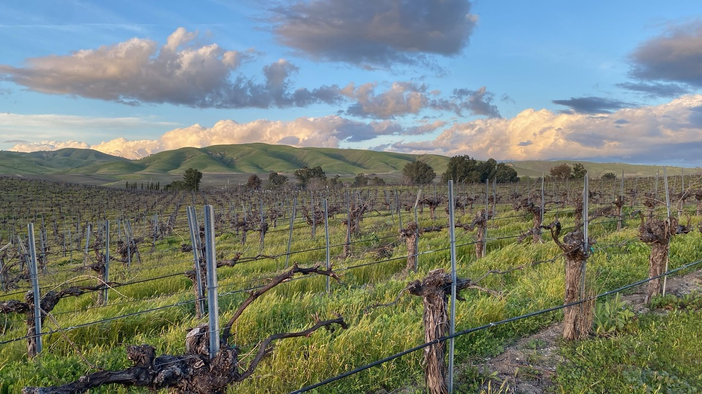

# Paso Robles

Paso Robles is a wine region in northern San Luis Obispo County on California's
Central Coast. Its vineyards occupy the inland side of the Santa Lucia Range,
where warm summer days meet varying amounts of Pacific cooling. The region
combines an established [Zinfandel](../grapes/zinfandel.md) tradition with
[Cabernet Sauvignon](../grapes/cabernet-sauvignon.md), Rhône varieties, and a
wide range of blends.

The American viticultural area (AVA) contains eleven smaller AVAs established
in 2014. These districts give more precise geographical information than a
simple division into vineyards east and west of the Salinas River.[^1]

## Heat, air flow, and water

The mountains partly shelter Paso Robles from the ocean. Western hills are
steeper and broken by canyons; farther east, vineyards spread across rolling
terrain and river plains. Calcareous shale is important in some western
vineyards, alongside soils derived from sandstone, granite, volcanic rock,
and river deposits elsewhere. Differences in soil depth and water storage
change how a vineyard handles a dry summer.

The Templeton Gap describes both a district and the route by which cool marine
air enters through passes in the Santa Lucia Range. Afternoon breezes reach
beyond the named district into other parts of Paso Robles. Their strength
depends on the vineyard's position relative to those air routes. Two sites
at similar distances from the coast can consequently experience different
ripening conditions.

Warm days support the ripening of later varieties, while cooler evenings
change the pace of ripening and acid loss. That combination leaves growers
with important harvest choices: waiting for more mature flavors also permits
further sugar accumulation. Picking date, crop level, and water availability
help determine whether a wine feels supple and fresh or broader and more
alcoholic.

## Grapes and blending

Cabernet Sauvignon and [Merlot](../grapes/merlot.md) share the region with
[Syrah](../grapes/syrah.md), [Grenache](../grapes/grenache.md), and
[Mourvèdre](../grapes/mourvedre.md). Rhône-inspired blends provide a particularly
useful way to understand Paso Robles: a producer can adjust fruit, color,
[tannin](../concepts/tannin.md), and freshness through the proportions of
varieties as well as through extraction and maturation.

Tablas Creek offers a documented example in the Adelaida District. The Perrin
and Haas families purchased its site in 1989, imported vine material from
Château de Beaucastel, and multiplied it for their own vineyards and other
growers. Its red blends draw principally on Mourvèdre, Grenache, Syrah, and
[Counoise](../grapes/counoise.md); whites use grapes including
[Roussanne](../grapes/roussanne.md), [Viognier](../grapes/viognier.md), and
[Grenache Blanc](../grapes/grenache-blanc.md). Native-yeast fermentation and
large, neutral oak vessels are part of its approach. The estate connects
Rhône-inspired winemaking with a nursery program that made those grapes
available to other growers.

## Zinfandel's continuity

The Dusi family's vineyards connect contemporary Paso Robles to earlier
Italian-American farming. The Wine History Project of San Luis Obispo County
documents Dante Dusi's transmission of head pruning and [dry farming](../concepts/dry-farming.md) to later
generations. Head-trained vines form individual bushes instead of a continuous
trellised wall; dry farming relies on stored soil moisture and rainfall.

J Dusi Wines continues that family connection through Janell Dusi's wines from
the family's vineyards. Its vineyard account describes the west-side property
planted in 1945 and continuing use of cover crops and dry farming. These
practices show why old vineyards are valuable historical records, while also
making clear that vine age, training, soil, and farming act together. Dry
farming's suitability remains site-specific.

## Related topics

- [Pruning and training](../concepts/pruning-and-training.md)
- [Oak maturation](../concepts/oak-maturation.md)

[^1]: Alcohol and Tobacco Tax and Trade Bureau, final rule establishing eleven
    viticultural areas within Paso Robles, 9 October 2014, effective 10 November
    2014.

## Sources

- Alcohol and Tobacco Tax and Trade Bureau, [“Establishment of the Adelaida
  District … and Templeton Gap District Viticultural Areas”](https://www.govinfo.gov/content/pkg/FR-2014-10-09/pdf/2014-24169.pdf),
  *Federal Register*, 9 October 2014.
- Paso Robles Wine Country Alliance, [“Geography & Climate”](https://pasowine.com/paso-robles/geography-climate/),
  accessed 6 October 2026.
- Christopher Taranto, [“Templeton Gap District”](https://pasowine.com/templeton-gap-district/),
  Paso Robles Wine Country Alliance, 4 August 2021.
- Tablas Creek Vineyard, [“History”](https://tablascreek.com/story/history),
  accessed 6 October 2026.
- Wine History Project of San Luis Obispo County, [“Dante Silvestro Dusi
  (1925–2015), Zinfandel Grower”](https://winehistoryproject.org/dante-silvestro-dusi-1925-2014/).
- J Dusi Wines, [“Dusi Vineyard”](https://www.jdusiwines.com/dusi-vineyard/),
  accessed 6 October 2026.
