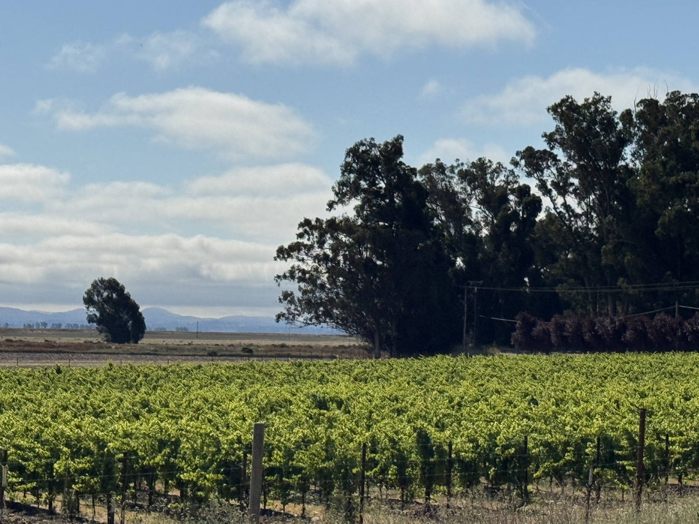

# Sonoma County

Sonoma County is a broad wine-growing area in northern California, extending
from the Pacific coast to inland valleys and the mountains beside
[Napa Valley](napa-valley.md). It encompasses cool Pinot Noir and Chardonnay
districts, warmer Cabernet country, and a substantial tradition of
Zinfandel-based wines. The county's breadth makes its smaller regions useful
guides to growing conditions.

Sonoma County is a county appellation, distinct from the Sonoma Valley and
Sonoma Coast American Viticultural Areas, or AVAs. A Sonoma County label can
encompass fruit from several different districts; it should not be read as a
synonym for the town of Sonoma or the valley around it.

## A county of contrasting growing places

The Pacific influences western vineyards directly and reaches inland through
gaps in the coastal hills. The Russian River corridor, Petaluma Gap, and San
Pablo Bay bring cool air into different parts of the county. Exposure to those
routes helps determine how long a vineyard remains foggy and how quickly it
warms during the day.

The [Russian River Valley](russian-river-valley.md) and
[Sonoma Coast](sonoma-coast.md) are important settings for
[Pinot Noir](../grapes/pinot-noir.md) and
[Chardonnay](../grapes/chardonnay.md). Warmer inland districts such as
[Alexander Valley](alexander-valley.md) and Knights Valley offer a longer
accumulation of heat for
[Cabernet Sauvignon](../grapes/cabernet-sauvignon.md). Hillsides add changes
in exposure, soil depth, and water availability within each district.

[Dry Creek Valley](dry-creek-valley.md) gives another point of orientation. Its
[Zinfandel](../grapes/zinfandel.md) and
[Sauvignon Blanc](../grapes/sauvignon-blanc.md) connect the county to both
older mixed vineyards and contemporary varietal wines. Farther south,
[Carneros](carneros.md) crosses the Sonoma–Napa county boundary, illustrating how a growing
area can follow climate and terrain across an administrative line.

## Old vineyards and contemporary wines

Ridge's Lytton Springs estate in Dry Creek Valley documents the mixed-variety
tradition particularly clearly. Old Zinfandel vines grow alongside
[Petite Sirah](../grapes/durif.md), [Carignan](../grapes/carignan.md), and smaller
amounts of other grapes. Ridge describes
fermenting varieties and lots separately before assembling the wine. A
[mixed planting](../concepts/field-blends.md) therefore need not imply that all its fruit is harvested and
fermented together.

This approach preserves more than old trunks. Companion varieties can change
the blend's acidity, colour, and tannin, while separate lots allow the
winemaker to respond to differences in ripening. Ridge began making Lytton
Springs in 1972 and later purchased the estate, giving the example a sustained
history as well as a current farming context.

Alexander Valley illustrates another strand of Sonoma wine. Its modern
Cabernet development includes Robert Young's planting in the 1960s and Rodney
Strong's early vineyard-designated Cabernet. The county's Cabernet
growers work across valley floor, benchland, and hillside positions, with
different exposure and root-zone conditions even within one appellation.

## Reading a Sonoma label

A smaller place name gives more geographical information, but it does not
establish a hierarchy of quality. A producer may deliberately blend fruit
across districts, or use a broader appellation for a wine from one site.

Federal origin rules distinguish the categories: a county appellation requires
at least 75% of the wine to derive from fruit grown in that county, while an
AVA requires at least 85% from grapes grown within its boundary. Other
production and applicable state requirements also apply.[^1] The winery's
street address alone does not establish where its grapes were grown.

[^1]: Alcohol and Tobacco Tax and Trade Bureau, “Wine Labeling: Appellation of
    Origin,” domestic appellation requirements, accessed 6 October 2026.

## Related topics

- [Vineyard year](../concepts/vineyard-year.md)
- [Tannin](../concepts/tannin.md)

## Sources

- Sonoma County Winegrowers, [“Sonoma County
  Terroir”](https://sonomawinegrape.org/visit/sonoma-county-terroir/), regional
  overview, accessed 6 October 2026.
- Sonoma County Tourism, [“Sonoma Wine
  Facts”](https://www.sonomacounty.com/wine/sonoma-wine-facts/), geography and
  regional overview, accessed 6 October 2026.
- Ridge Vineyards, [“Lytton
  Springs”](https://www.ridgewine.com/vineyards/lytton-springs/), vineyard
  history and winemaking, accessed 6 October 2026.
- Sonoma County Winegrowers, [“The Beauty and History of Alexander Valley
  Cabernet Sauvignon”](https://sonomawinegrape.org/the-beauty-and-history-of-alexander-valley-cabernet-sauvignon/),
  2023.
- Alcohol and Tobacco Tax and Trade Bureau, [“Wine Labeling: Appellation of
  Origin”](https://www.ttb.gov/regulated-commodities/beverage-alcohol/wine/labeling-wine/wine-labeling-appellation-of-origin),
  accessed 6 October 2026.
